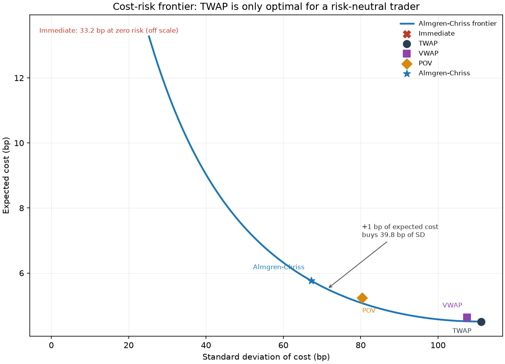
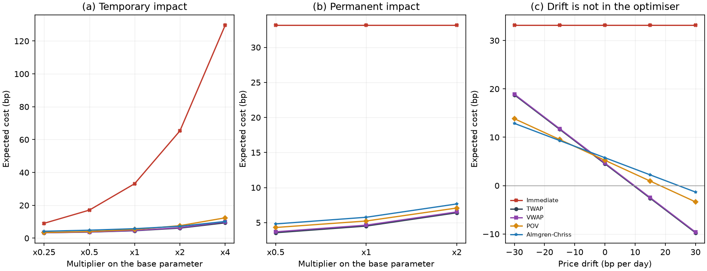
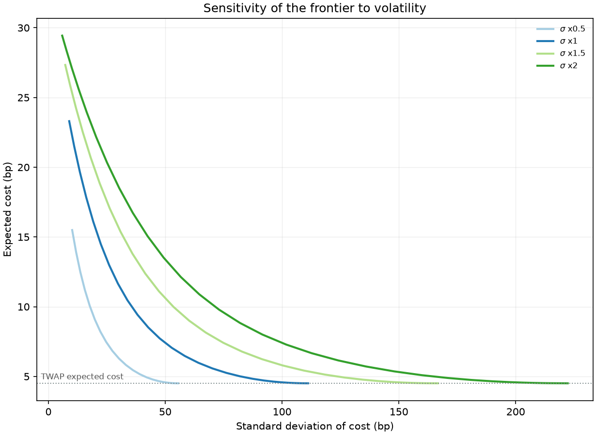

# execution-simulator

[](https://github.com/IkerAbad/execution-simulator/actions/workflows/ci.yml)
[](LICENSE)
[](https://www.python.org/)

Execution cost simulator for large orders. It compares immediate execution, TWAP,
VWAP, POV and the Almgren-Chriss optimal schedule under an explicit impact model,
against a finite-depth order book, and measures the **total cost of the order**, not
its average price.

The point of the project is the last word: two schedules can show the same average
execution price and very different total cost once impact, spread and the risk of
holding the position are accounted for.

## What is modelled

A liquidation of `X` shares over a horizon `T`, sliced into `N` intervals of length
`τ = T/N`. The mid price and the execution price of interval `k` are

```
S_k  = S_{k−1} + σ·√τ·ξ_k − γ·n_k            permanent impact + noise
S̃_k  = S_{k−1} − (s + η·n_k/τ)                half spread + temporary impact
```

with `σ` the volatility per √time, `γ` the permanent impact per share, `η` the
temporary impact and `s` the half spread. The implementation shortfall of the
schedule `n_1 .. n_N` then has closed-form moments

```
E[IS]  = ½·γ·X² + s·X + (η − ½·γ·τ)/τ · Σ n_k²
Var[IS] = σ²·τ·Σ x_k²
```

where `x_k` is the inventory still open after interval `k`. All the algebra, including
the discrete `½·γ·τ` correction, is in [`docs/derivation.md`](docs/derivation.md).

The reference scenario is a 100,000-share sell order at 50 currency units (5,000,000
notional), one trading day in 20 intervals, 2% daily volatility, and a book with
2,000 shares at the touch and thinning levels one cent apart. The linear `η` is
calibrated to reproduce the book's slippage at the average child order, so the two
execution models agree at the size the analytics are meant to describe.

## Quick start

```bash
python -m venv .venv
.venv\Scripts\activate          # Windows
pip install -e ".[dev]"
python -m execution_sim compare
```

```
algorithm         E[cost] (bp)     SD (bp)    E+lam*Var (bp)
------------------------------------------------------------
Immediate               33.160       0.000            33.160
TWAP                     4.508     111.131            10.683
VWAP                     4.641     107.500            10.419
POV                      5.234      80.389             8.465
Almgren-Chriss           5.766      67.172             8.022
```

Regenerate every number and figure in this README:

```bash
python -m execution_sim report --out results --figures figures --paths 20000 --seed 7
```

## The five algorithms

| Algorithm | What it does | Where it comes from |
|---|---|---|
| Immediate | Sends the whole order in the first interval | Baseline, zero risk, maximum impact |
| TWAP | Equal shares per interval | Minimum expected cost when impact is linear |
| VWAP | Shares proportional to a synthetic U-shaped volume profile | Tracks the market's volume |
| POV | Fixed participation rate of market volume, horizon endogenous | Rate algorithm, finishes early |
| Almgren-Chriss | Minimises `E[IS] + λ·Var[IS]` | Closed form, derived by hand |

POV runs at 1.5 times the neutral rate `X / daily_volume`, so it completes at 0.75 of
the horizon. At exactly the neutral rate POV collapses into the VWAP schedule; there
is a test for that identity.

## Results

Reference scenario, risk aversion `λ = 10⁻⁶` (implied `κ = 3.64 /day`):

| Algorithm | E[cost] (bp) | SD (bp) | E + λ·Var (bp) | First interval (%) | Completion (d) |
|---|---|---|---|---|---|
| Immediate | 33.160 | 0.000 | 33.160 | 100.0 | 0.05 |
| TWAP | 4.508 | 111.131 | 10.683 | 5.0 | 1.00 |
| VWAP | 4.641 | 107.500 | 10.419 | 7.9 | 1.00 |
| POV | 5.234 | 80.389 | 8.465 | 11.8 | 0.75 |
| Almgren-Chriss | 5.766 | 67.172 | 8.022 | 16.7 | 1.00 |

Units are basis points of the 5,000,000 notional. The Almgren-Chriss row minimises the
mean-variance objective; every other row pays an excess of between 0.44 and 25 bp of
risk-adjusted cost. Note that the optimal schedule does **not** have the lowest
expected cost: it trades expected cost for a large reduction in dispersion.


## TWAP is not optimal

TWAP minimises expected cost. That is a theorem under linear impact: since

```
E[IS] = constants + (η − ½γτ)/τ · Σ n_k²
```

and `Σ n_k²` is minimised by equal trades subject to `Σ n_k = X`. It is also the
`λ → 0` endpoint of the frontier, so it is not dominated in the (risk, cost) plane
either.

The catch is that it is optimal only for a **risk-neutral** trader. Any `λ > 0` makes
the objective

```
J = E[IS] + λ·Var[IS]
```

and TWAP is not a stationary point of `J`: the first-order effect on expected cost is
zero (it is a minimum of `E`), while the first-order effect on variance is not. The
loss is easy to quantify with the frontier:

| Risk aversion | E TWAP (bp) | E AC (bp) | ΔE (bp) | SD TWAP (bp) | SD AC (bp) | ΔSD (bp) | J TWAP (bp) | J AC (bp) | Loss (%) |
|---|---|---|---|---|---|---|---|---|---|
| 0 | 4.508 | 4.508 | 0.000 | 111.131 | 111.131 | 0.000 | 4.508 | 4.508 | 0.00 |
| 10⁻⁷ | 4.508 | 4.554 | 0.046 | 111.131 | 101.875 | −9.255 | 5.125 | 5.073 | 1.02 |
| 10⁻⁶ | 4.508 | 5.766 | 1.258 | 111.131 | 67.172 | −43.959 | 10.683 | 8.022 | **24.91** |
| 10⁻⁵ | 4.508 | 11.344 | 6.836 | 111.131 | 30.750 | −80.381 | 66.258 | 16.072 | **75.74** |
| 10⁻⁴ | 4.508 | 23.304 | 18.796 | 111.131 | 8.906 | −102.225 | 622.008 | 27.270 | **95.62** |

Read the middle row: by paying 1.26 bp more in expected cost, the optimal schedule
removes 44 bp of standard deviation and cuts the risk-adjusted cost by 25%. For a
trader with `λ = 10⁻⁵` the same TWAP schedule is 76% worse than necessary.

The frontier is flat near `λ = 0`, so the argument is even sharper when it is made
without choosing a `λ` at all: **one extra basis point of expected cost buys 39.8 bp
of risk reduction**, moving the standard deviation from 111.1 bp to 71.3 bp. That is
0.025 bp of expected cost per bp of standard deviation. Ignoring risk is cheap only
if you never look at the second moment.



## Finite liquidity

The linear model is a local approximation. The simulator walks a real ladder and
charges each level its own price, so a child order that fits in the touch pays the
touch and a block pays the whole book. At the average child order (5,000 shares) the
calibrated linear model and the book agree to the cent. At the full order as one
block the book is **84% more expensive** than the linear model, and the gap keeps
growing with size.

That is the difference between "average price" and "total cost": the same volume
traded in three child orders instead of one is cheaper by a factor that the average
price of the parent order does not show.

## Sensitivity

Temporary impact is the parameter that punishes immediacy: multiplying `η` by four
takes immediate execution from 33 bp to 130 bp while the sliced schedules move by a
few basis points. Permanent impact moves the sliced schedules almost linearly, and it
does not touch immediate execution at all, because in this discrete convention the
first trade never trades against its own permanent impact (see the derivation).
Volatility shifts the whole frontier to the right without changing its shape. A drift
that the optimiser ignores moves the ranking: with a rising price the slow schedules
gain, because waiting is rewarded, and the expected-cost ordering inverts.





## How the optimum is obtained

No external optimisation library. The first-order conditions of the discrete problem
form a tridiagonal linear system, which is solved with a hand-written Thomas
algorithm; the closed form is obtained by solving the Euler-Lagrange recurrence

```
−x_{k−1} + (2 + c)·x_k − x_{k+1} = 0,      c = λ·σ²·τ²/η̃
```

with a hyperbolic ansatz, giving

```
x_k = X · sinh(κ·(T − t_k)) / sinh(κ·T),      cosh(κ·τ) = 1 + λ·σ²·τ²/(2·η̃)
```

Both routes are implemented and must agree. See
[`docs/derivation.md`](docs/derivation.md) for the full derivation.

## Validation

* **Closed form vs numerical solution.** `tests/test_almgren_chriss.py` compares the
  sinh solution with the Thomas solution for 25 combinations of risk aversion and
  number of intervals. Maximum difference: `2.9·10⁻¹¹` shares on a 100,000-share
  order.
* **Optimality.** The test suite also checks the Euler-Lagrange residual point by
  point, verifies that no feasible perturbation lowers the objective, and runs an
  independent coordinate-descent solver that converges to the same path.
* **Analytic moments vs simulation.** `tests/test_engine.py` runs 40,000 Monte Carlo
  paths per algorithm with linear impact and no drift, and checks the mean against
  `E[IS]` (within five standard errors) and the standard deviation against
  `σ·√(τ·Σx²)` (within 1%). In the reference report the z-scores stay within
  ±1.9 and the dispersion error within 0.7%.
* **The book.** Level consumption is tested exactly, the calibrated small-order
  slippage matches the linear model at the touch, and the cost function is checked to
  be convex in the child order size.

`ruff`, `mypy --strict` and `pytest` run in CI on every push, together with a job that
regenerates the report and the figures and uploads them as artifacts.

## Repository layout

```
src/execution_sim/
├── core.py              model parameters and the execution problem
├── impact.py            closed-form expected cost and variance
├── almgren_chriss.py    closed form, Thomas solution, kappa, half-life
├── schedules.py         immediate, TWAP, VWAP, POV, the algorithm registry
├── book.py              finite-depth ladder and level consumption
├── volume.py            synthetic U-shaped intraday volume
├── engine.py            Monte Carlo simulator
├── frontier.py          cost-risk frontier and the price of risk
├── sensitivity.py       parameter and volatility sweeps
├── report.py            the tables quoted in this README
├── figures.py           every figure in this README
└── cli.py               `execution-sim`
tests/                   analytic, book, engine, frontier, sensitivity, figures, CLI
docs/derivation.md       the algebra, by hand
results/summary.md       the generated report
figures/                 the generated figures
```

## Limitations

* **No real data.** Prices, volumes and impact parameters are synthetic. Nothing here
  is calibrated to a specific venue, and the simulator does not connect to any
  exchange.
* **Linear impact for the analytics.** The closed form assumes linear permanent and
  temporary impact and no drift. With a drift the Almgren-Chriss schedule is a
  plug-in rule, not the exact optimum.
* **A static book that refills.** Liquidity is not depleted across intervals, queue
  position is ignored, and the ladder shape is fixed.
* **Gaussian prices.** No jumps, no stochastic volatility, no cross-impact between
  assets.
* **Risk is measured as variance**, so the model is symmetric and risk-neutral in the
  tails. Expected shortfall would tell a different story.

## License

MIT. See [LICENSE](LICENSE).
